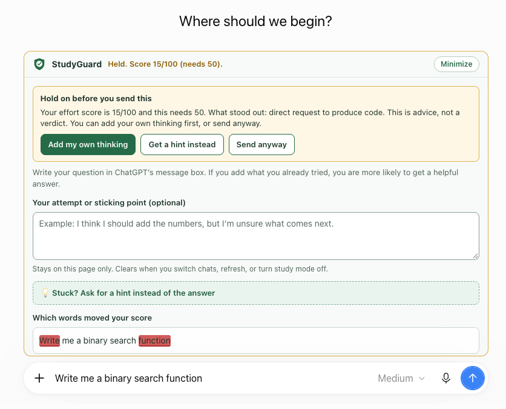
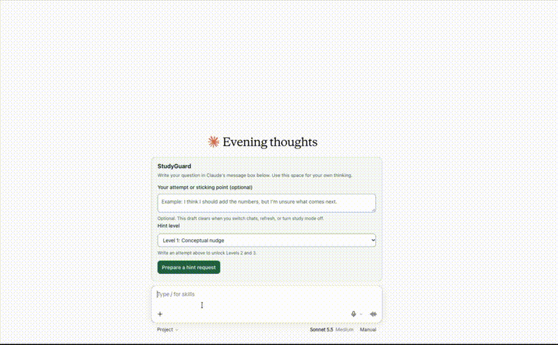
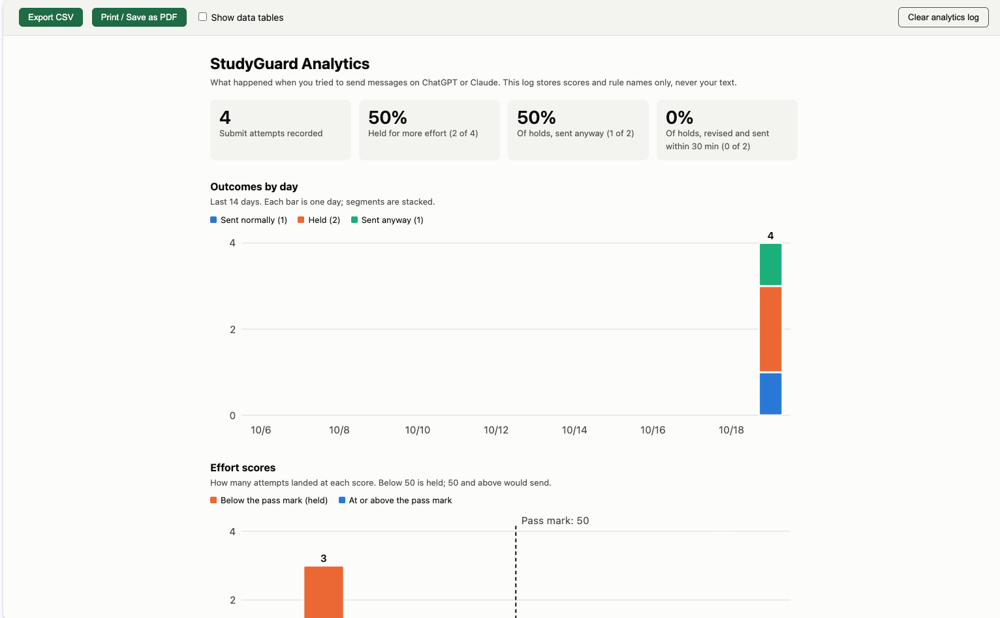
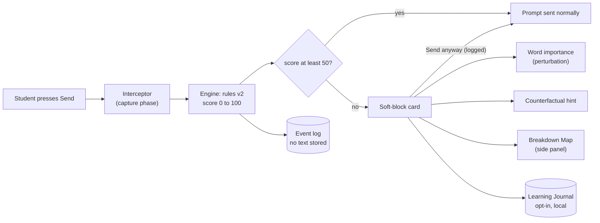
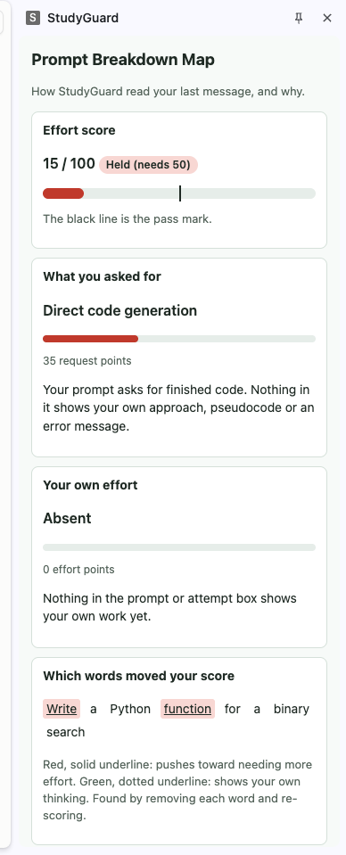
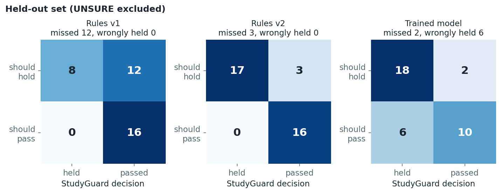
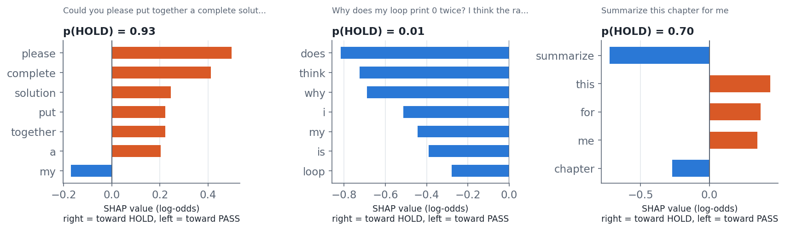

# StudyGuard

**A Chrome extension that explains, in plain language, why a prompt to ChatGPT or Claude looks like "give me the answer" rather than "help me learn" - and coaches the student toward a better prompt.**

Built for AIPI 590 (Explainable AI), Duke University, by Eugenia Tate.





---

## Contents

1. [Why this exists](#why-this-exists)
2. [What it does](#what-it-does)
3. [How it works](#how-it-works)
4. [Quick start](#quick-start)
5. [Try it in 60 seconds](#try-it-in-60-seconds)
6. [Results](#results)
7. [Reproduce everything](#reproduce-everything)
8. [Repository map](#repository-map)
9. [Privacy and data](#privacy-and-data)
10. [Limitations and responsible use](#limitations-and-responsible-use)
11. [Documentation index](#documentation-index)
12. [Credits, AI assistance and license](#credits-ai-assistance-and-license)

---

## Why this exists

Students increasingly ask AI chatbots for finished code, essays and answers. Research on learning suggests that unrestricted answer access can undermine learning, while guided help (hints, explanations, feedback on an attempt) does not. Most tools that respond to this either do nothing or block silently, which is opaque and feels punitive.

StudyGuard asks a different **research and design question**:

> Can a small, fully transparent classifier tell *answer-seeking* prompts from *effort-showing* prompts well enough to nudge students, while explaining every decision so the student can see, contest and learn from it?

The focus is **explainability and responsible design**, not detection or policing. The tool never decides that someone is cheating. It reports what the wording of a prompt signals, shows which words mattered, and tells the student what to add. The student can always override ("Send anyway"), and the override is logged for the student's own reflection.

## What it does

| Feature | What the student sees |
|---|---|
| **Soft block** | When Send is pressed on a prompt that scores below the pass mark, a card appears instead of sending. |
| **Prompt Breakdown Map** (side panel) | Intent (e.g. "Direct code generation") and Student Effort (e.g. "Absent") with a plain-language explanation. |
| **Word importance** | The exact words that pushed the score toward "answer-seeking" or "effort", found by removing each word and re-scoring. |
| **Counterfactual hint** | The smallest change that would unlock the prompt, e.g. "Paste the exact error message, or say which line fails and what happened" or "Write at least 5 words of your own approach in the attempt box". Each suggestion is checked by re-scoring. |
| **Attempt box and hint levels** | A place to type your own attempt or sticking point, which raises the score. Choose how much help to ask for: Level 1 is a conceptual nudge; Levels 2 and 3 unlock once you have written an attempt. |
| **Learning Journal** (opt-in) | A record of prompts, attempts and outcomes you can export as Markdown or PDF to hand in with homework. |
| **Analytics dashboard** | Hold rate, recoveries (held, then improved), score distribution and most common triggers; export to CSV or PDF. Built only from a log that never stores prompt text. |



Supported sites: **chatgpt.com** and **claude.ai** (Chrome 116 or newer, because of the side panel).

## How it works



**Three layers of explanation**

1. **Local rule engine** (`engine.js`): transparent signals with fixed weights. A prompt starts at 50; request signals ("write", "give me the full code", "just the answer") subtract points; effort signals (error messages, "I tried", your own attempt) add points. 50 or more passes. Scores are rule points, **not probabilities**.
2. **Perturbation** (`perturbation.js`): remove each word, re-score, and record the change. This is the same idea as LIME and occlusion methods, exact and instant because the engine is small.
3. **Counterfactual hints** (`counterfactual.js`): finds the smallest additions that would pass, in the spirit of counterfactual explanations (Wachter, Mittelstadt and Russell, 2017).

**A trained model as a research companion** (not the default decision-maker): a TF-IDF + logistic regression classifier (`model.js`, trained in Python with scikit-learn and exported as JSON). It lets the project compare explanation methods - exact SHAP, LIME and perturbation - on the same model and measure how faithful and stable they are.

## Quick start

**Requirements:** Google Chrome 116+. No build step, API key, account, dataset download or paid service is needed to *use* the extension.

1. Download or clone this repository.
2. Open `chrome://extensions` and switch on **Developer mode**.
3. Click **Load unpacked** and choose the repository folder (the one containing `manifest.json`).
4. Open <https://chatgpt.com> or <https://claude.ai>, and click the StudyGuard icon to open the popup (it links to the side panel, journal and dashboard).

To run the tests and evaluation you also need **Node.js 18+**. The Python research pipeline needs **Python 3.10+** (see [Reproduce everything](#reproduce-everything)).

## Try it in 60 seconds

Type each prompt into ChatGPT or Claude and press Send.

| Prompt | Expected result |
|---|---|
| `Write a Python function for a binary search` | **Held**, score about 15. "Write" and "function" are flagged as answer-seeking. |
| Same prompt, plus an attempt in the attempt box: `I would compare the middle element with the target and discard half the list each time until found` | **Passes**, score about 58. |
| `Why does my loop skip the last item? Here is my attempt: for i in range(len(a)-1): print(a[i])` | **Passes**, score about 92. |
| `Give me a hint for problem 3` | **Passes** (asking for a hint is a learning request). |

Open the side panel (popup, "Open Prompt Breakdown Map") to see the breakdown after a hold.



## Results

The rule engine was benchmarked on **blind-labelled prompts** (HOLD / PASS / UNSURE; labels frozen before results were seen). The **held-out set** (36 decided prompts) was drafted and labelled before the improved rules (v2) existed and was never used to tune them. Prompts were drafted by an AI assistant, not collected from students, and labelled by one annotator. Brackets are 95% Wilson confidence intervals.

| Held-out set | Rules v1 | **Rules v2 (default)** | Trained model |
|---|---|---|---|
| Accuracy | 67% [50-80] | **92% [78-97]** | 78% [62-88] |
| Recall (answer-seeking prompts caught) | 40% [22-61] | 85% [64-95] | 90% [70-97] |
| Honest prompts wrongly held (of 16) | 0 | **0** | 6 |



Key findings:

- Rules v2 never wrongly held an honest prompt on the held-out set, but the sample is small (see intervals).
- The trained model catches slightly more answer-seeking prompts but wrongly holds many honest ones, so **rules v2 stays the default**.
- **Random cross-validation was misleading**: 100% accuracy on template-generated data, versus about 67-70% when whole prompt categories are held out. See `docs/figures/cv_comparison.png`.
- **Counterfactual hints** are valid and minimal for every held prompt (58 of 58): following the advice reaches the pass line, and every step is needed. But nothing checks that the content is real thinking (see the red-team results).
- **Red-team stress test** (40 cases): rules v2 catches 13% of paraphrased requests and 43% of obfuscated ones, while the trained models catch more but wrongly hold 38% of short honest prompts. Wording-based tools have blind spots; this one is a nudge, not enforcement.
- **Explanations agree on the model** (SHAP, LIME and occlusion: rank correlation 0.93-0.96), but **rule-perturbation explanations do not transfer to the model** (about 0.37). An explanation is only faithful to the system it explains.



Full details: [rules v1 vs v2](docs/v2-results.md), [model vs rules](docs/model-results.md), [explanation fidelity](docs/explanation-fidelity.md), [Python SHAP/LIME run](docs/python-explanations.md), [error analysis](docs/error-analysis.md).

## Reproduce everything

```bash
# 1. Unit tests (Node 18+; no installs needed)
node --test                                  # expect: tests 145, pass 145, fail 0

# 2. Benchmarks (human labels live in eval/*.csv)
node eval/check-labels.js eval/heldout.csv   # label summary
node eval/benchmark.js --set heldout --rules v1
node eval/benchmark.js --set heldout --rules v2
node eval/benchmark.js --set heldout --rules model                               # JS-trained model
node eval/benchmark.js --set heldout --rules model --model model.sklearn.json    # scikit-learn model
node eval/explanation_eval.js                # agreement, faithfulness, stability
node eval/counterfactual_eval.js             # are the hints valid and minimal?
node eval/redteam.js                         # stress test: evasion, gaming, over-flagging

# 3. Python research pipeline (Python 3.10+)
pip install -r python/requirements.txt
python3 train/make_training_data.py          # regenerate the 400 synthetic training prompts
python3 python/train_sklearn.py              # train, export model/model.sklearn.json, write parity cases
python3 python/explain_shap_lime.py --out docs/python-explanations.md
node eval/export_predictions.js && python3 python/make_figures.py
jupyter notebook python/studyguard_analysis.ipynb
```

**Data and model provenance**

| Item | Where | Origin |
|---|---|---|
| Dev set (90 prompts) | `eval/prompts.csv` | Drafted by an AI assistant (Claude) from category descriptions, plus 6 prompts the author added; labelled blind by the author. Used while building v2, so results on it are optimistic. |
| Held-out set (40 prompts) | `eval/heldout.csv` | Drafted by the same AI assistant before v2 existed; labelled blind by the author; **test only**. |
| Red-team cases (40) | `eval/redteam.csv` | Written by the AI assistant to probe weaknesses; expected outcomes are by design. A stress test, not an accuracy measure. |
| Training set (400 prompts) | `eval/train.csv` | Template-generated by `train/make_training_data.py` (fixed seed). No overlap with dev or held-out (enforced by a test). |
| Models | `model/model.json`, `model/model.sklearn.json` | Trained locally on the training set only. No pretrained weights or downloads. |

## Repository map

Where to find things, top to bottom.

```text
StudyGuard/
├── manifest.json            Chrome extension manifest (MV3): permissions, content scripts, side panel
├── README.md                You are here
├── LICENSE                  MIT license
├── .gitignore               Files Git should not track (caches, OS files, secrets)
├── icons/                   Reserved for extension icons (currently empty)
│
├── ── EXTENSION UI ───────────────────────────────────────────────────────
├── popup.html / .js / .css  Toolbar popup: settings, journal opt-in, links to the pages below
├── content.js / .css        Runs inside ChatGPT/Claude: wires everything together, shows the soft-block card
├── sidepanel.html/.js/.css  Prompt Breakdown Map (Chrome side panel)
├── journalpage.html/.js/.css  Learning Journal viewer and Markdown / PDF export
├── dashboard.html/.js/.css  Analytics dashboard (charts, CSV / PDF export)
│
├── ── CORE LOGIC (plain JavaScript, no dependencies, testable in Node) ───
├── engine.js                Rule-based scorer (rules v1 and v2), the default decision-maker
├── perturbation.js          Word-importance by removal (LIME-like)
├── counterfactual.js        "What would unlock this?" hint generator
├── breakdownmap.js          Turns an analysis into the Breakdown Map data
├── gate.js                  Decides hold vs send for a submission
├── interceptor.js           Captures Send clicks / Enter before the page does
├── sites.js                 Per-site adapters (selectors for ChatGPT and Claude)
├── eventlog.js              Privacy-safe event log (no prompt text)
├── journal.js               Opt-in local journal storage
├── journalexport.js         Builds the Markdown / printable journal report
├── analytics.js             Aggregates the event log for the dashboard and CSV
│
├── ── TRAINED MODEL AND EXPLANATIONS ─────────────────────────────────────
├── model.js                 TF-IDF + logistic regression: train and run in JavaScript
├── explain.js               Occlusion, exact SHAP and LIME-style explanations for the model
├── model/                   Exported models (model.json: JS-trained; model.sklearn.json: scikit-learn)
├── train/                   make_training_data.py (generator), train_model.js (JS trainer)
├── python/                  scikit-learn training, real shap/lime run, figures, notebook, parity files
│
├── ── EVALUATION ─────────────────────────────────────────────────────────
├── eval/                    Labelled prompt sets (CSV), benchmark and explanation-evaluation scripts
│
├── ── DOCUMENTATION ──────────────────────────────────────────────────────
├── docs/                    Plans, annotation guide, results, error analysis, ethics (index below)
│   ├── figures/             Charts generated by python/make_figures.py
│   └── images/              Screenshots used in the README
│
└── tests/                   145 automated tests (node --test)
```

**"I want to..." quick navigation**

| I want to... | Go to |
|---|---|
| Understand how a score is computed | `engine.js` (signals and weights are listed at the top) |
| See why a word was highlighted | `perturbation.js`, then `docs/explanation-fidelity.md` |
| See how the hint is chosen and verified | `counterfactual.js` |
| Change which sites are supported | `sites.js` and `manifest.json` (`matches`) |
| Check what is stored about me | `eventlog.js`, `journal.js`, and [Privacy and data](#privacy-and-data) |
| Re-run the evaluation | `eval/benchmark.js`, `docs/annotation-guide.md` |
| See the labelled data | `eval/prompts.csv`, `eval/heldout.csv`, `eval/train.csv` |
| Read the research plan and literature | `docs/project-plan.md` |
| Read the risks and limits | `docs/limitations-and-ethics.md` |
| Reproduce the SHAP / LIME work | `python/explain_shap_lime.py`, `python/studyguard_analysis.ipynb` |

## Privacy and data

- **Everything runs locally in your browser.** The extension makes no network requests and sends no data anywhere. No API key or account is used.
- The **event log** (used by the dashboard) records only time, site, action, score and which rules fired - **never the text of a prompt**. It keeps the latest 500 events.
- The **Learning Journal is off by default**. If you switch it on, prompts and attempts are stored in Chrome's local extension storage (latest 200 entries), only on your computer, so you can export a record. You can clear it at any time from the popup.
- The extension fails open: if something goes wrong, your prompt is sent normally.

## Limitations and responsible use

StudyGuard measures **the wording of a prompt**, not what the student intends to do. It cannot tell a student who is stuck from one who is avoiding work, and it must **not** be used as an academic-integrity detector or for discipline. Known limits:

- Small evaluation sets, drafted mostly by an AI assistant (not collected from students) and labelled by a single annotator; confidence intervals are wide. The assistant that drafted the prompts also helped build the rules, so shared blind spots are possible.
- The trained model was fit to synthetic template data and does not transfer cleanly to varied wording.
- Mostly English; paraphrase, role-play and indirection ("print it") can slip through; padding a prompt with filler phrases can raise the score.
- Website changes can break the page integration; the selectors for each site live in `sites.js` and will need updating when ChatGPT or Claude change their pages.
- No user study was run, so we do not know whether the explanations actually help students.

Read the full analysis of stakeholders, failure modes and misuse risks in [`docs/limitations-and-ethics.md`](docs/limitations-and-ethics.md).

## Documentation index

| Document | What it covers |
|---|---|
| [`docs/project-plan.md`](docs/project-plan.md) | Research question, background, design rationale, literature |
| [`docs/evaluation-plan.md`](docs/evaluation-plan.md) | How the system is evaluated |
| [`docs/annotation-guide.md`](docs/annotation-guide.md) | How prompts were labelled blind |
| [`docs/evaluation-results.md`](docs/evaluation-results.md) | Dev-set benchmark of rules v1 |
| [`docs/v2-results.md`](docs/v2-results.md) | Rules v1 vs v2 on held-out and dev sets |
| [`docs/model-results.md`](docs/model-results.md) | Trained model vs rules |
| [`docs/model-heldout-report.md`](docs/model-heldout-report.md) | Per-category results and every mistake the model made on the held-out set |
| [`docs/explanation-fidelity.md`](docs/explanation-fidelity.md) | Agreement, faithfulness and stability of explanations |
| [`docs/python-explanations.md`](docs/python-explanations.md) | Real `shap` and `lime` libraries vs occlusion |
| [`docs/error-analysis.md`](docs/error-analysis.md) | What the v1 rules get wrong and why |
| [`docs/counterfactual-results.md`](docs/counterfactual-results.md) | Are the "what to add" hints valid and minimal? |
| [`docs/redteam-results.md`](docs/redteam-results.md) | Stress test: paraphrase, role-play, obfuscation, filler, over-flagging |
| [`docs/limitations-and-ethics.md`](docs/limitations-and-ethics.md) | Stakeholders, risks, misuse, deployment |

## Credits, AI assistance and license

Created by **Eugenia Tate** for AIPI 590 (Explainable AI), Project 1, Duke University. Design, evaluation, labelling and decisions are the author's; the code was developed with assistance from Claude (Anthropic) as an AI pair-programmer, with the author reviewing, testing and committing every change.

Methods referenced: LIME (Ribeiro, Singh and Guestrin, 2016), SHAP (Lundberg and Lee, 2017), counterfactual explanations (Wachter, Mittelstadt and Russell, 2017). Full references are in `docs/project-plan.md`.

Released under the [MIT License](LICENSE).
